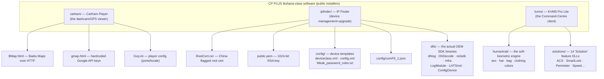
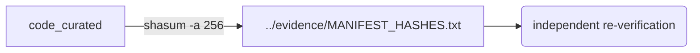

# The Code — what it does and how to use it

This folder holds the **key technical code artifacts** extracted from CP PLUS's own public PC tools that power the Ikshana-class vans. Every file here is a byte-for-byte copy of a file CP PLUS distributes publicly. Their entire purpose in this repo is **proof**: they are the specific pieces of code the audit's findings point at.

> These are **not** exploits. They are configuration files, HTML pages, certificates, and UI assets shipped inside CP PLUS's installers. Reviewing them is the same as reading a vendor manual — it is public documentation in code form.

---

## Code map



---

## `carkam/` — the CarKam Player (dashcam/GPS video viewer)

This is CP PLUS's own **GPS CarKam Player**, the desktop program used to view footage from the mobile van's dashcam/GPS cameras. Three code files are the proof.

### `carkam/BMap.html`
**What it is:** the player's map screen. It loads **Baidu Maps** (a Chinese mapping service) for tracking vehicle GPS position.

**What the code proves:**
- It loads map scripts over **plain HTTP** (`http://api.map.baidu.com`), not HTTPS — so any network observer can inject or tamper with what the map shows.
- The map comments inside are written in **GB2312-encoded Chinese** — the player was authored by the Chinese OEM and shipped un-translated inside CP PLUS's release.

**How to use it (verify yourself):**
```bash
grep -n 'http://' code/carkam/BMap.html          # plain-HTTP map script
iconv -f GB2312 -t UTF-8 code/carkam/BMap.html   | head   # Chinese author text
```

### `carkam/gmap.html`
**What it is:** a second map screen that uses Google Maps instead.

**What the code proves:**
- It contains **two hardcoded Google Maps API keys** baked into CP PLUS's public player. Anyone can extract them from the public download.
- (Use webfetch to check the exact quote in the html file.)

**How to use it:**
```bash
grep -oE 'AIza[0-9A-Za-z_-]{20,}' code/carkam/gmap.html   # the keys
```

### `carkam/Gvp.ini`
**What it is:** the player's runtime configuration (language, ports, defaults).

**What the code proves:**
- The player is multi-language with **Chinese-first locales** (chs/cht/eng/…), consistent with OEM authorship.
- It references the `GVP` (GPS Video Player) internal name — the OEM code name.

**How to use it:**
```bash
cat code/carkam/Gvp.ini
```

---

## `ipfinder/` — the IP Finder device-management tool

The tool CP PLUS tells dealers to run to find, configure, and **upgrade batches of devices** on a network. Two certificate files and a config folder are the proof.

### `ipfinder/RootCert.cer`
**What it is:** a root certificate bundled into the tool that talks to devices.

**What the code proves:**
- Subject: `CN=General, O=General, C=CN` — **`C=CN` = China** country flag.
- It is a **self-signed** root of a private CA used for device TLS — the "trust" is CP PLUS's own, chained to a Chinese root.
- Issued 2017, expires 2027.

**How to use it:**
```bash
openssl x509 -in code/ipfinder/RootCert.cer -noout -subject -issuer -dates -fingerprint
```

### `ipfinder/public.pem`
**What it is:** an RSA public key the tool ships.

**What the code proves:**
- **1024-bit RSA** — a key length that has been considered weak for years and is discouraged in production cryptography.

**How to use it:**
```bash
openssl rsa -pubin -in code/ipfinder/public.pem -text -noout | head
```

### `ipfinder/config/`
| File | What it does |
|---|---|
| `deviceclass.xml` | The device-class table the tool uses to enumerate supported gear (ACS door stations, ARC alarm hosts, VDP video door phones, Android intercoms, cameras). Confirms the tool manages a whole Chinese-OEM device family, not just CP PLUS boxes. |
| `config.xml` | Tool-level configuration (paths, log, defaults). |
| `Weak_password_rules.txt` | A ruleset the tool ships for detecting **weak passwords on devices** — evidence the OEM ecosystem knows weak default credentials (`admin/Admin123.`) are endemic. |
| `comF6_1.json` | A serial/COM configuration used for device upgrades over serial links. |

**How to use it:**
```bash
grep -i 'pass' code/ipfinder/config/Weak_password_rules.txt
grep -cE 'class' code/ipfinder/config/deviceclass.xml
cat code/ipfinder/config/config.xml | head -40
```

---

## `kvms/` — KVMS Pro Lite, the Command-Centre client

The window into the whole van fleet. Two things matter.

### `kvms/humantrait/` — the soft-biometric engine
**What it is:** the icon set for the NVMS "Human Trait" filter — the UI that lets an operator search people by **appearance**.

**What the code proves:**
- The filter categories are: **sex** (`sex_*`), **hat** (`hat_*`), **bag** (`bag_*`), **clothing color** (`cotta_*`), **sleeve length** (`longsleeve_*`), **shorts vs trousers vs skirt** (`shorts_*`, `trousers_*`, `skirt_*`).
- **None of these is identity.** Searching "man, grey longsleeve, shorts, red bag, no hat" is appearance classification — the "facial AI" CP PLUS markets reduces to this.

**How to use it:**
```bash
ls code/kvms/humantrait/            # the full attribute vocabulary
# sex_* hat_* bag_* cotta_* longsleeve_* shorts_* trousers_* skirt_*
```

### `ipfinder/dlls/` — the actual OEM SDK binaries
**What they are:** the compiled native libraries the IP Finder tool loads to talk to devices. These are the **real code** behind the Ikshana-class management stack.

**What the code proves:**
- `dhlog.dll` — "Dahua log": the OEM's logging library.
- `DhDecode.dll` — "Dahua decode": the OEM's video-stream decoder.
- `netsdk.dll` (22 MB) — the OEM's **network SDK** entry-point library (`NetSDK`), the classic Dahua-family SDK surface.
- `avnetsdk.dll` (2.8 MB) — secondary OEM net SDK component.
- `Infra.dll` / `Inframd.dll` — OEM infrastructure libraries.
- `LogModule.dll` / `LogMoudle.dll` — OEM logging (note the OEM's own misspelling "Moudle", a telltale).
- `LHTSmd.dll` — OEM "Smart med" (motion-detection) library.
- `ConfigDevice.dll` — device config API.
- `netsdk_kvms.dll` — the **KVMS variant** of `netsdk.dll` (31 MB), proving the VMS talks to the same OEM device surface.

The `DH`/Dahua-named set is compiled Chinese-OEM SDK code shipped inside CP PLUS's public tool — the single strongest "this is OEM" artifact in the repo.

**How to use it:**
```bash
# identities visible in the binary itself (PE metadata / string table)
strings code/ipfinder/dlls/dhlog.dll | grep -i dahu   | head
strings code/ipfinder/dlls/netsdk.dll  | grep -i 'net sdk\|dahu' | head
openssl x509 -in code/ipfinder/RootCert.cer -noout -subject -issuer   # the China root these talk to
```

### `kvms/solutions/` — the Command-Centre client
**What they are:** the 14 "Solution" plugin DLLs that make up the KVMS Pro Lite VMS (the Command & Control Centre client used to watch the van fleet).

**What the code proves:**
- The VMS is a **generic multi-appliance surveillance suite** — RealMonitorUI (live), PlayBackUI, DeviceManagerUI, SystemConfigUI, AlarmCenterUI, UserManagerUI, VIntercomConfigUI (intercom), VIMainControlUI — *not* a bespoke "Ikshana" build.
- The `netsdk_kvms.dll` in `dlls/` proves the VMS device layer is the same OEM SDK as IP Finder's.

**How to use it:**
```bash
find code/kvms/solutions/dlls -name '*.dll' | sort   # the 14 solution plugins
strings code/ipfinder/dlls/netsdk.dll | grep -i 'dahua\|net sdk' | head
```

---

## Relationship to the full repo

- The **byte-for-byte originals** of these files live under the heavy `evidence/software/*_ext/` trees (kept on disk, SHA-256-hashed, **not** committed to git).
- The **full analysis** is in `../docs/AUDIT_REPORT.md` (18 findings), `../docs/proofs/PROOF_ChinaTech.md` (7-point China-OEM proof), and `../docs/proofs/PROOF_FacialBroken.md` (6-point facial-AI proof).
- The **plain-language article** is `../docs/ARTICLE_PLAIN.md`.

## Hash ledger



The authoritative SHA-256 ledger for the raw binaries is `../evidence/MANIFEST_HASHES.txt` and `../evidence/software/HASHES.txt`. The curated copies in `code/` are extracted from those hashed originals, and their own hashes are in `HASHES.txt` (same folder).